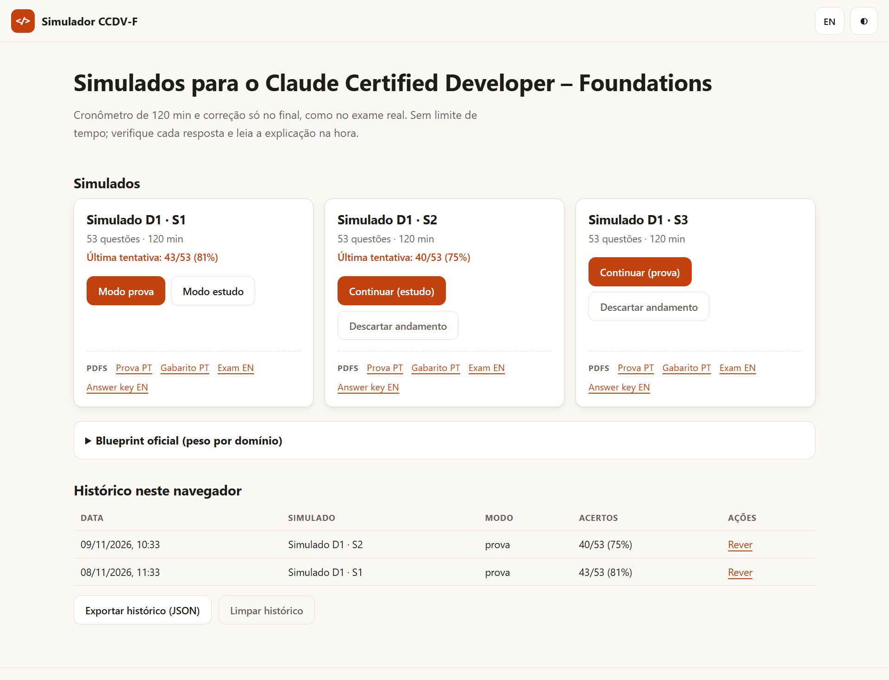
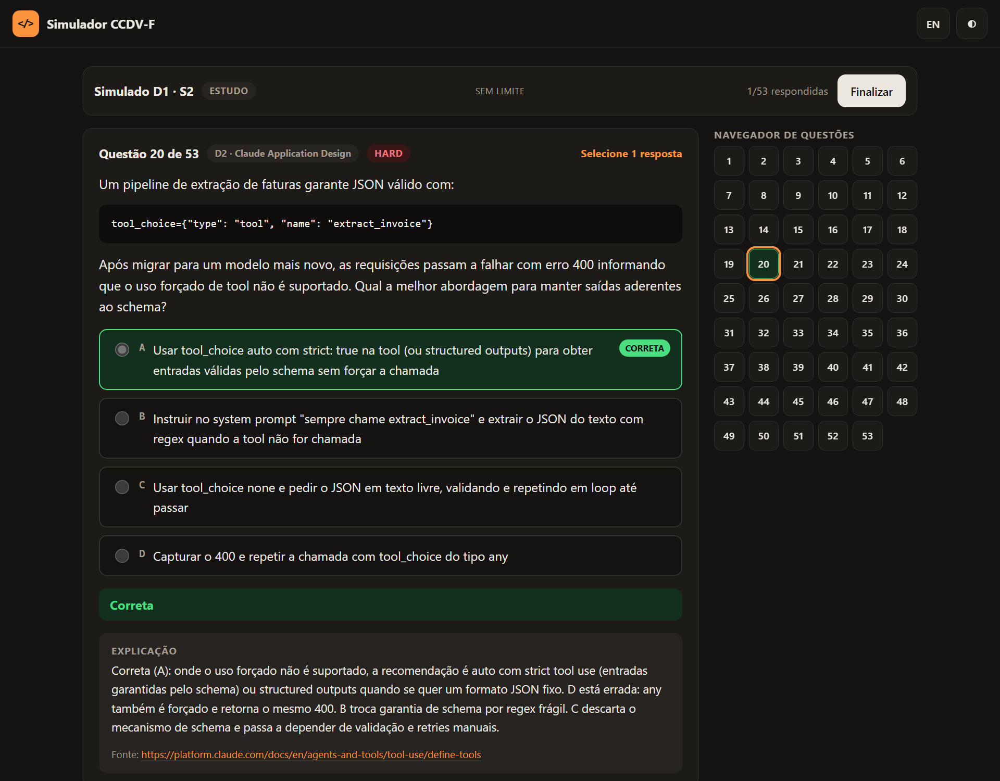
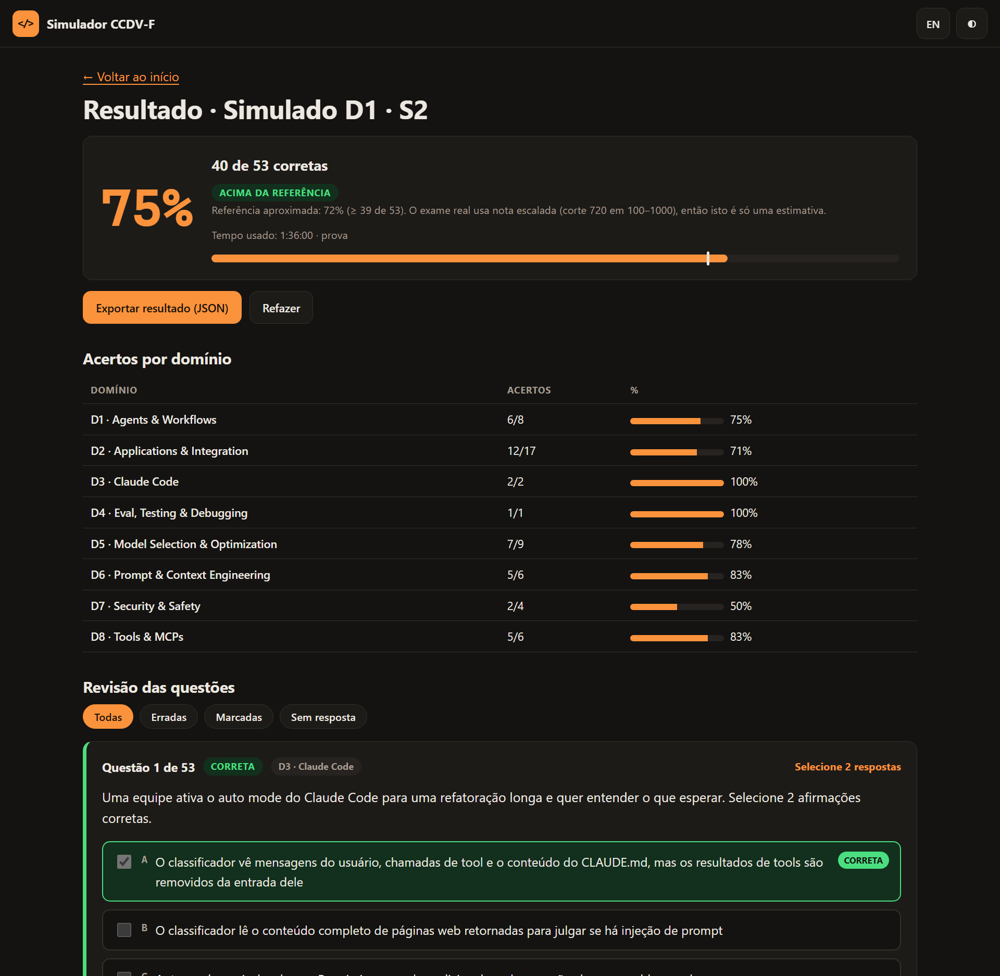
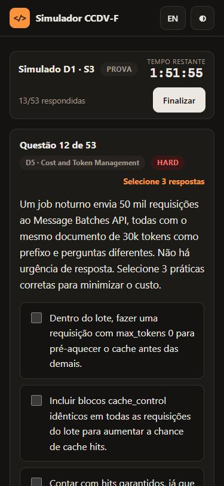
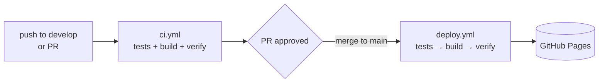

<div align="center">

# CCDV-F Simulator

**Practice exams for the Claude Certified Developer – Foundations**, in English and Portuguese.<br>
Plain HTML, CSS and JavaScript. No frameworks, no bundler, no server.

[](https://github.com/danhpaiva/claude-certified-developer-simulator-html-css-js/actions/workflows/ci.yml)
[](https://github.com/danhpaiva/claude-certified-developer-simulator-html-css-js/actions/workflows/deploy.yml)
[](https://danhpaiva.github.io/claude-certified-developer-simulator-html-css-js/)
[](LICENSE)


[**Open the simulator →**](https://danhpaiva.github.io/claude-certified-developer-simulator-html-css-js/)

[Português](README.md) · [English](README.en.md)



</div>

> **Disclaimer:** unofficial study material with original questions. It does not reproduce real exam items (confidential under NDA) and is not affiliated with Anthropic. "Claude" is a trademark of Anthropic, PBC.

## Table of contents

- [Features](#features)
- [Screenshots](#screenshots)
- [About the exam](#about-the-exam)
- [How the questions were made](#how-the-questions-were-made)
- [Run locally](#run-locally)
- [Tests and validation](#tests-and-validation)
- [CI/CD](#cicd)
- [Project structure](#project-structure)
- [Add a new practice exam](#add-a-new-practice-exam)
- [Roadmap](#roadmap)
- [Privacy](#privacy)
- [Contributing and reporting errors](#contributing-and-reporting-errors)
- [License](#license)

## Features

- **53-question practice exams**, like the real exam, in **English and Portuguese**. Switch language at any time, even mid-exam, without losing your answers.
- **Exam mode:** 120-minute timer and grading only at the end.
- **Study mode:** no time limit; check each answer and read the explanation, with the source link, right away.
- **Single-response and multiple-response** items ("Select N"). On multiple-response items you score only with the exact set, as in the real exam.
- **Question navigator**, flag for review, and keyboard shortcuts (`←` `→` navigate, `A`–`E` select, `F` flag).
- **Result by domain**, using the official blueprint weights, with a filterable review (all, wrong, flagged, unanswered) and JSON export.
- **Progress and history** saved in your browser. Close the tab and pick up later.
- **Export and import the history** (JSON) to take your progress to another browser. Import validates the type and range of every field, recomputes percentages, drops duplicates and reports how many items were accepted, repeated or rejected.
- **PDFs** of exam and answer key (PT and EN) for every practice exam, for offline study or printing.
- **Light and dark theme**, responsive layout and keyboard navigation.
- **Works offline:** after the first visit the site opens and the exams run without internet (service worker pre-caches the whole site). PDFs become available offline once opened.

## Screenshots

| Study mode: check and explanation | Result by domain and review |
| :---: | :---: |
|  |  |

<div align="center">

**On mobile**



</div>

## About the exam

> **Naming:** "**Day N · Exam M**" is the study order (plan day and exam number within the day). **D1 to D8** are the blueprint *domains*. They are different things.

The practice exams follow the **CCDV-F Exam Guide v1.0** (July 2026): 53 items in 120 minutes, single- and multiple-response, scaled score from 100 to 1,000 with a cut score of **720**. Each practice exam respects the domain weights:

| Domain | Weight | Questions per exam |
| --- | ---: | ---: |
| D1 · Agents & Workflows | 14.7% | 8 |
| D2 · Applications & Integration | 33.1% | 17 |
| D3 · Claude Code | 3.1% | 2 |
| D4 · Eval, Testing & Debugging | 2.6% | 1 |
| D5 · Model Selection & Optimization | 16.8% | 9 |
| D6 · Prompt & Context Engineering | 11.0% | 6 |
| D7 · Security & Safety | 8.1% | 4 |
| D8 · Tools & MCPs | 10.6% | 6 |

> The real exam score is scaled. The simulator shows a **72% correct** reference (≥ 39 of 53) only as a rough estimate, not as the official conversion.

## How the questions were made

The questions were written with the help of **Claude** and checked against the **official documentation**:

1. Every question cites the **source** (documentation page) that backs the answer, and the link appears in the explanation.
2. A second, independent review round compared the stem, the answer, **every wrong option** and the explanation with the cited page.
3. Model IDs, prices and fast-changing numbers were avoided.
4. An automated check prevents repeated stems across practice exams.

The platform changes often, so **there may be errors or items that became outdated**. When in doubt, the official documentation wins. See [how to report](#contributing-and-reporting-errors).

## Run locally

The site uses ES modules and `fetch`, so it needs a local server (opening the file straight from disk will not work):

```bash
npm run serve
# open http://localhost:8080
```

If the browser keeps showing an old version after you edit a `.js` file, do a hard reload (`Ctrl+Shift+R`). Running the site needs no install. Only the tests use a development dependency (`jsdom`); install it with `npm ci`.

## Tests and validation

```bash
npm test
```

It runs two checks (Node 20 or newer is the only requirement):

- **`check:js`:** syntax of every JavaScript module.
- **`validate`:** manifest with 8 domains and weights summing to 100; structure of each question; consistent number of answers; 4 options on single-response items and 5 on multiple-response; PT and EN with the same number of options; duplicate stems across exams; valid sources; existing PDFs; and `index.html` references.

## CI/CD

Two separate workflows:

| Workflow | When it runs | What it does |
| --- | --- | --- |
| [`ci.yml`](.github/workflows/ci.yml) | PRs and pushes on any branch | `check:js`, `validate`, unit tests, and `build` + `verify:build` |
| [`deploy.yml`](.github/workflows/deploy.yml) | push to `main` or manual | `npm test`, `build`, `verify:build` and publishing to GitHub Pages |



One-time setup on GitHub: **Settings → Pages → Build and deployment → Source: GitHub Actions**. The published site includes only `index.html`, `assets/`, `data/`, `pdfs/`, the manifest, the service worker and the share image.

**What `npm run build` does** (produces `_site/` without touching the source): versions the CSS, the manifest and **every** import between JS modules with `?v=<commit hash>`; writes the cache version and the offline pre-cache list into `sw.js`; and copies the `og:image` file. `npm run verify:build` checks the result (every referenced file exists, every URL is versioned, the pre-cache covers every module).

**Testing offline locally:** the service worker is off on `localhost` so it does not hide your edits. To try it, run `npm run build`, serve the `_site/` folder and open `http://localhost:8080/index.html?sw=1`.

## Project structure

```
index.html               single page, hash routes
assets/style/main.css    styles (CSS tokens, dark theme, responsive)
assets/js/               ES modules: main (routes), home, exam, result, train, stats,
                         question, dialogs (accessible confirm/notice), exams (loading),
                         analysis and importer (pure, tested logic), scoring, store, i18n, rich, dom
assets/icons/            PWA icons (PNG) and the SVG logo
data/exams.json          manifest (domains, weights, exams, PDFs)
data/exams/DIA1-SIM1.json    questions of each exam (PT + EN, answers, explanations)
pdfs/dia1/sim1/              PDFs of each exam (exam and answer key, PT and EN)
scripts/                 validate-data, check-js, build, verify-build (CI and deploy);
                         generate-icons.py (builds the PNGs in assets/icons/, needs Pillow)
docs/screenshots/        images used in this README
.github/workflows/       ci.yml and deploy.yml
```

## Add a new practice exam

Practice exams are generated outside the site and exported in the repository format: data goes to `data/exams/DIAn-SIMm.json` and the `data/exams.json` manifest is updated with the new entry. PDFs are **optional**: if provided, they go to `pdfs/diaN/simM/` and the `pdfs` field in the manifest points to them; otherwise the `pdfs` field is omitted and the site does not display the links row.

After adding the files:

```bash
npm test
git add data pdfs   # or just data, if there are no PDFs
git commit -m "feat: practice exam DIAn-SIMm"
```

The site reads the manifest and shows the new exam with no code changes.

## Roadmap

| Status | Item |
| :---: | --- |
| ✅ | Day 1 practice exams (Exam 1, 2 and 3, 159 questions) in PT and EN |
| ✅ | Static site with exam mode, study mode, history and PDFs |
| ✅ | CI and deploy in separate workflows |
| 🔜 | 14-day plan, up to 3 practice exams per day, with rising difficulty |
| 🔜 | Tune upcoming exams to the domains where performance was weakest |

## Privacy

Everything runs in your browser. History and progress live only in the browser's `localStorage`, and nothing is sent to a server. "Export result" downloads a local JSON file, handy for deciding what to study next.

## Contributing and reporting errors

Found a doubtful answer, an outdated explanation or a translation mistake? Open an issue with the **exam and question number** (for example, "Day 1 · Exam 2, question 20") and, if possible, the documentation page that contradicts the item. Data fixes must pass `npm test` before the PR.

## License

[MIT](LICENSE) © 2026 Daniel Paiva.
