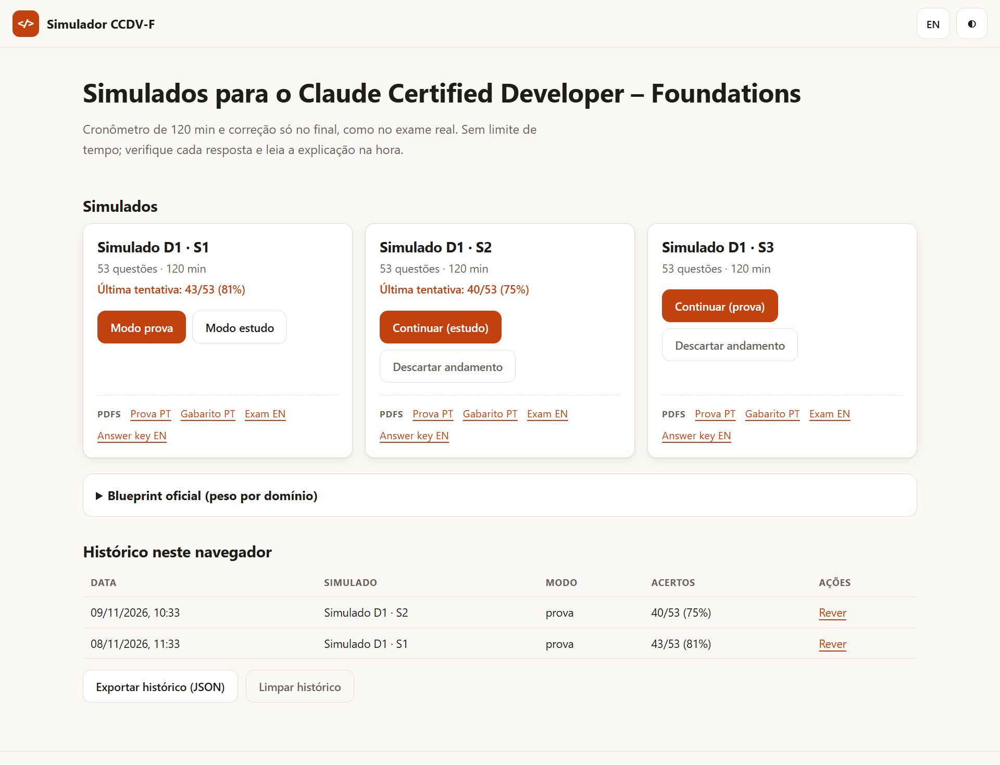
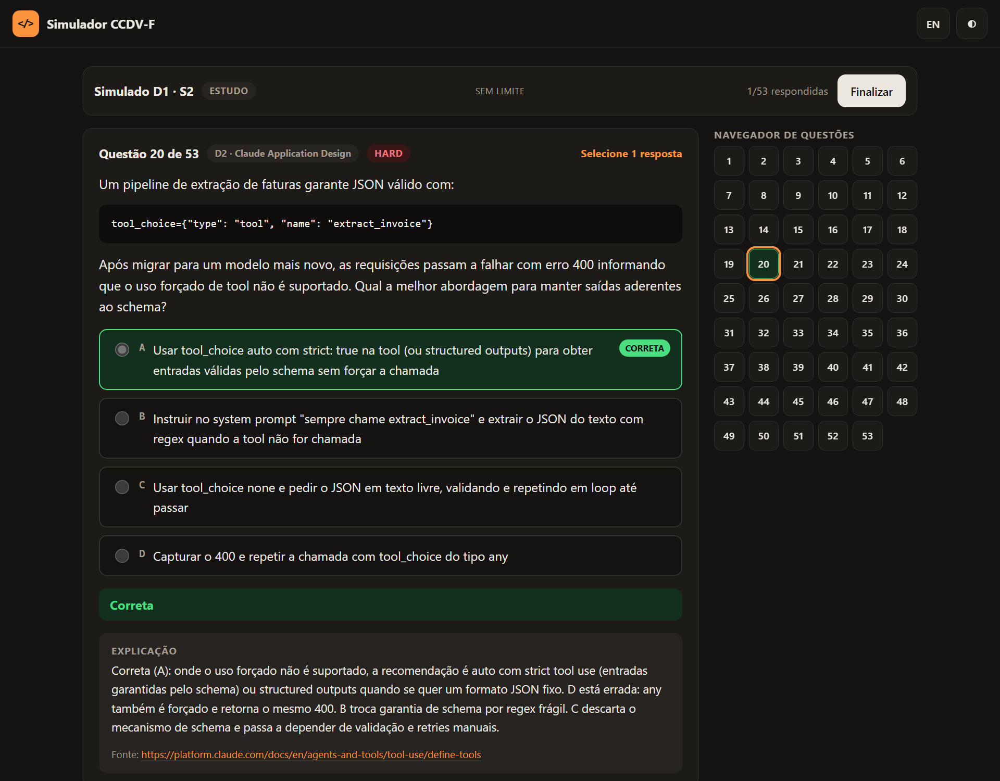
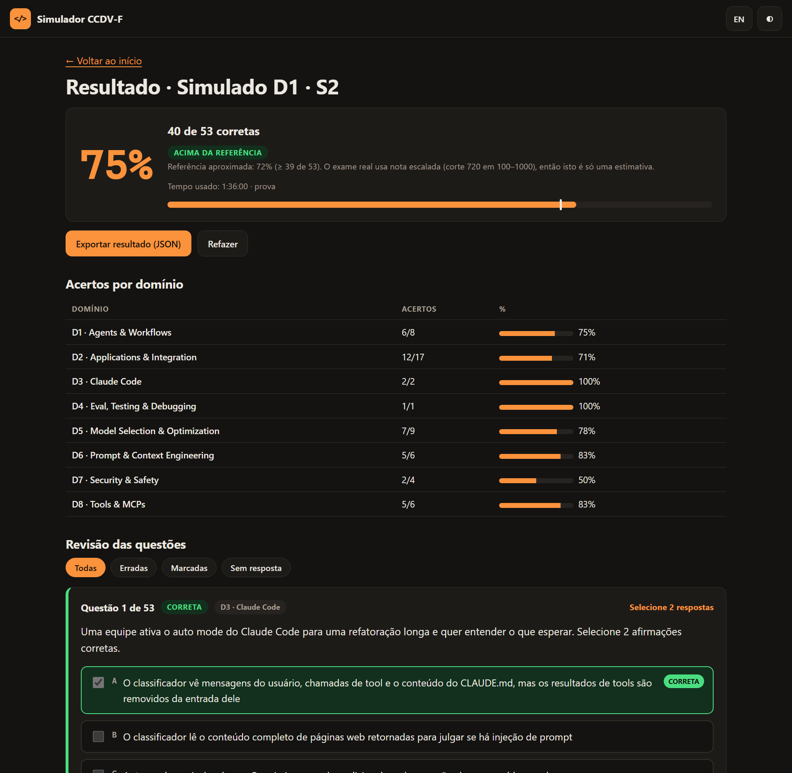
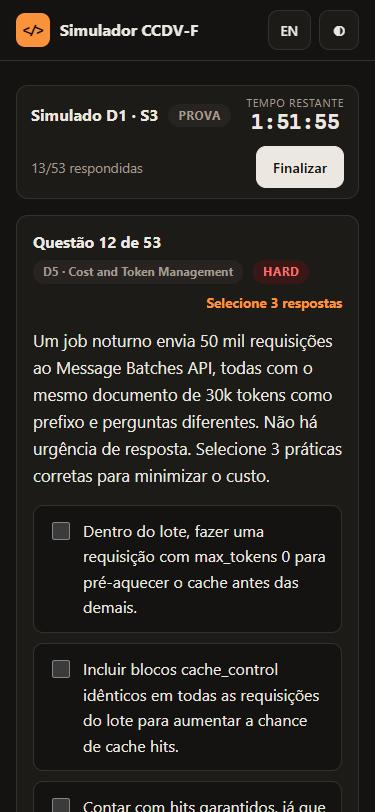
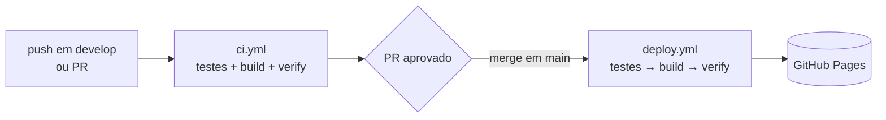

<div align="center">

# Simulador CCDV-F

**Simulados para o Claude Certified Developer – Foundations**, em português e inglês.<br>
HTML, CSS e JavaScript puros. Sem frameworks, sem bundler, sem servidor.

[](https://github.com/danhpaiva/claude-certified-developer-simulator-html-css-js/actions/workflows/ci.yml)
[](https://github.com/danhpaiva/claude-certified-developer-simulator-html-css-js/actions/workflows/deploy.yml)
[](https://danhpaiva.github.io/claude-certified-developer-simulator-html-css-js/)
[](LICENSE)


[**Abrir o simulador →**](https://danhpaiva.github.io/claude-certified-developer-simulator-html-css-js/)

[Português](README.md) · [English](README.en.md)



</div>

> **Aviso:** material de estudo **não oficial**, com questões originais. Não reproduz itens reais do exame (confidenciais por NDA) e não é afiliado à Anthropic. "Claude" é marca da Anthropic, PBC.

## Sumário

- [Recursos](#recursos)
- [Capturas de tela](#capturas-de-tela)
- [Sobre o exame](#sobre-o-exame)
- [Como as questões foram feitas](#como-as-questões-foram-feitas)
- [Rodar localmente](#rodar-localmente)
- [Testes e validação](#testes-e-validação)
- [CI/CD](#cicd)
- [Estrutura do projeto](#estrutura-do-projeto)
- [Adicionar um novo simulado](#adicionar-um-novo-simulado)
- [Roteiro](#roteiro)
- [Privacidade](#privacidade)
- [Contribuir e reportar erros](#contribuir-e-reportar-erros)
- [Licença](#licença)

## Recursos

- **Simulados de 53 questões**, como no exame real, em **português e inglês**. A troca de idioma funciona a qualquer momento, até no meio da prova, sem perder as respostas.
- **Modo prova:** cronômetro de 120 minutos e correção só no final.
- **Modo estudo:** sem limite de tempo; verifique cada resposta e leia a explicação, com o link da fonte, na hora.
- **Resposta única e múltipla resposta** ("Selecione N"). Nas de múltipla resposta, acerta-se só com o conjunto exato, como no exame.
- **Navegador de questões**, marcação para revisão e atalhos de teclado (`←` `→` navegam, `A`–`E` marcam, `F` marca para revisão).
- **Resultado por domínio**, com os pesos do blueprint oficial, revisão filtrável (todas, erradas, marcadas, sem resposta) e exportação em JSON.
- **Andamento e histórico** salvos no navegador. Você pode fechar a aba e continuar depois.
- **Exportar e importar o histórico** (JSON) para levar o progresso a outro navegador. A importação valida tipo e faixa de cada campo, recalcula os percentuais, descarta duplicatas e informa quantos itens foram aceitos, repetidos ou recusados.
- **PDFs** de prova e gabarito (PT e EN) de cada simulado, para estudar offline ou imprimir.
- **Tema claro e escuro**, layout responsivo e navegação por teclado.
- **Funciona offline:** depois do primeiro acesso, o site abre e as provas rodam sem internet (service worker com pré-cache de todo o site). Os PDFs ficam disponíveis offline depois de abertos uma vez.

## Capturas de tela

| Modo estudo: verificação e explicação | Resultado por domínio e revisão |
| :---: | :---: |
|  |  |

<div align="center">

**No celular**



</div>

## Sobre o exame

> **Nomes:** "**Dia N · Simulado M**" é a ordem de estudo (dia do plano e número do simulado no dia). **D1 a D8** são os *domínios* do blueprint. São coisas diferentes.

Os simulados seguem o **Exam Guide CCDV-F v1.0** (julho de 2026): 53 itens em 120 minutos, escolha única e múltipla resposta, nota escalada de 100 a 1.000 com corte em **720**. Cada simulado respeita o peso dos domínios:

| Domínio | Peso | Questões por simulado |
| --- | ---: | ---: |
| D1 · Agents & Workflows | 14,7% | 8 |
| D2 · Applications & Integration | 33,1% | 17 |
| D3 · Claude Code | 3,1% | 2 |
| D4 · Eval, Testing & Debugging | 2,6% | 1 |
| D5 · Model Selection & Optimization | 16,8% | 9 |
| D6 · Prompt & Context Engineering | 11,0% | 6 |
| D7 · Security & Safety | 8,1% | 4 |
| D8 · Tools & MCPs | 10,6% | 6 |

> A nota do exame real é escalada. O simulador mostra a referência de **72% de acertos** (≥ 39 de 53) apenas como estimativa grosseira, não como a conversão oficial.

## Como as questões foram feitas

As questões foram escritas com ajuda do **Claude** e conferidas contra a **documentação oficial**:

1. Cada questão cita a **fonte** (página da documentação) que sustenta a resposta, e o link aparece na explicação.
2. Uma segunda rodada de revisão independente confrontou enunciado, resposta, **cada alternativa errada** e explicação com a página citada.
3. Foram evitados IDs de modelo, preços e números que mudam rápido.
4. Uma verificação automática impede enunciados repetidos entre simulados.

A plataforma muda com frequência e **pode haver erros ou itens que ficaram desatualizados**. Em caso de dúvida, vale a documentação oficial. Veja [como reportar](#contribuir-e-reportar-erros).

## Rodar localmente

O site usa módulos ES e `fetch`, então precisa de um servidor local (abrir o arquivo direto do disco não funciona):

```bash
npm run serve
# abra http://localhost:8080
```

Se o navegador mostrar uma versão antiga depois de editar um `.js`, faça um recarregamento forçado (`Ctrl+Shift+R`). Para rodar o site não é preciso instalar nada. Só os testes usam uma dependência de desenvolvimento (`jsdom`); instale com `npm ci`.

## Testes e validação

```bash
npm test
```

Executa duas verificações (só precisa do Node 20 ou superior):

- **`check:js`:** sintaxe de todos os módulos JavaScript.
- **`validate`:** manifesto com 8 domínios e pesos somando 100; estrutura de cada questão; quantidade de respostas coerente; 4 opções nas de resposta única e 5 nas de múltipla resposta; PT e EN com o mesmo número de opções; enunciados duplicados entre simulados; fontes válidas; PDFs existentes; e referências do `index.html`.

## CI/CD

Dois workflows separados:

| Workflow | Quando roda | O que faz |
| --- | --- | --- |
| [`ci.yml`](.github/workflows/ci.yml) | PRs e pushes em qualquer branch | `check:js`, `validate`, testes unitários e `build` + `verify:build` |
| [`deploy.yml`](.github/workflows/deploy.yml) | push em `main` ou manual | `npm test`, `build`, `verify:build` e publicação no GitHub Pages |



Configuração única no GitHub: **Settings → Pages → Build and deployment → Source: GitHub Actions**. O site publicado inclui apenas `index.html`, `assets/`, `data/`, `pdfs/`, o manifesto, o service worker e a imagem de compartilhamento.

**O que o `npm run build` faz** (gera `_site/` sem alterar o código-fonte): versiona com `?v=<hash do commit>` o CSS, o manifesto e **todos** os imports entre módulos JS; grava a versão do cache e a lista de pré-cache offline no `sw.js`; e copia a imagem do `og:image`. O `npm run verify:build` confere o resultado (todo arquivo referenciado existe, toda URL está versionada, o pré-cache cobre todos os módulos).

**Testar o offline localmente:** o service worker fica desligado em `localhost` para não esconder suas edições. Para testá-lo, rode `npm run build`, sirva a pasta `_site/` e abra `http://localhost:8080/index.html?sw=1`.

## Estrutura do projeto

```
index.html               página única, rotas por hash
assets/style/main.css    estilos (tokens CSS, tema escuro, responsivo)
assets/js/               módulos ES: main (rotas), home, exam, result, train, stats,
                         question, dialogs (confirmação/aviso acessíveis), exams (carregamento),
                         analysis e importer (lógica pura, testada), scoring, store, i18n, rich, dom
assets/icons/            ícones do PWA (PNG) e o logo em SVG
data/exams.json          manifesto (domínios, pesos, simulados, PDFs)
data/exams/DIA1-SIM1.json    questões de cada simulado (PT + EN, respostas, explicações)
pdfs/dia1/sim1/              PDFs de cada simulado (prova e gabarito, PT e EN)
scripts/                 validate-data, check-js, build, verify-build (CI e deploy);
                         generate-icons.py (gera os PNGs de assets/icons/, requer Pillow)
docs/screenshots/        imagens deste README
.github/workflows/       ci.yml e deploy.yml
```

## Adicionar um novo simulado

Os simulados são gerados fora do site e exportados no formato do repositório: os dados vão para `data/exams/DIAn-SIMm.json` e o manifesto `data/exams.json` é atualizado com o novo item. Os PDFs são **opcionais**: se fornecidos, vão para `pdfs/diaN/simM/` e o campo `pdfs` no manifesto aponta para eles; caso contrário, o campo `pdfs` é omitido e o site não exibe a linha de links.

Depois de adicionar os arquivos:

```bash
npm test
git add data pdfs   # ou só data, se não houver PDFs
git commit -m "feat: simulado DIAn-SIMm"
```

O site lê o manifesto e passa a exibir o novo simulado sem nenhuma mudança de código.

## Roteiro

| Situação | Item |
| :---: | --- |
| ✅ | Simulados do Dia 1 (Simulado 1, 2 e 3, 159 questões) em PT e EN |
| ✅ | Site estático com modo prova, modo estudo, histórico e PDFs |
| ✅ | CI e deploy em workflows separados |
| 🔜 | Plano de 14 dias, com até 3 simulados por dia, aumentando a dificuldade |
| 🔜 | Ajustar os próximos simulados aos domínios em que o desempenho foi pior |

## Privacidade

Tudo roda no seu navegador. O histórico e o andamento ficam só no `localStorage` do navegador, e nada é enviado a servidor. "Exportar resultado" baixa um JSON local, útil para decidir o que estudar a seguir.

## Contribuir e reportar erros

Achou uma resposta duvidosa, uma explicação desatualizada ou um erro de tradução? Abra uma *issue* informando o **simulado e o número da questão** (por exemplo, "Dia 1 · Simulado 2, questão 20") e, se possível, a página da documentação que contradiz o item. Correções de dados devem passar por `npm test` antes do PR.

## Licença

[MIT](LICENSE) © 2026 Daniel Paiva.
